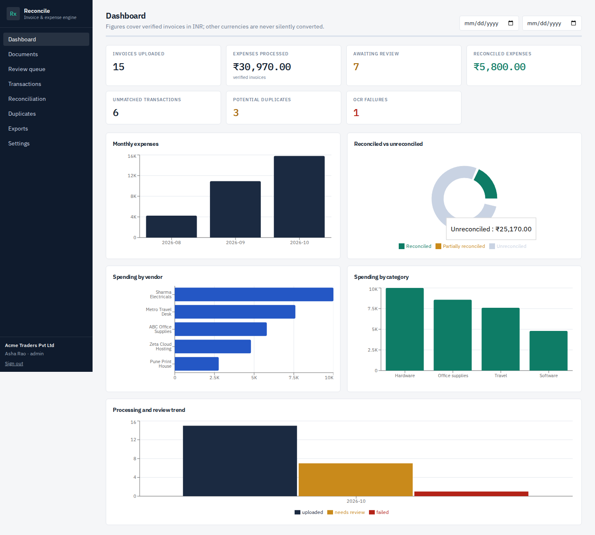
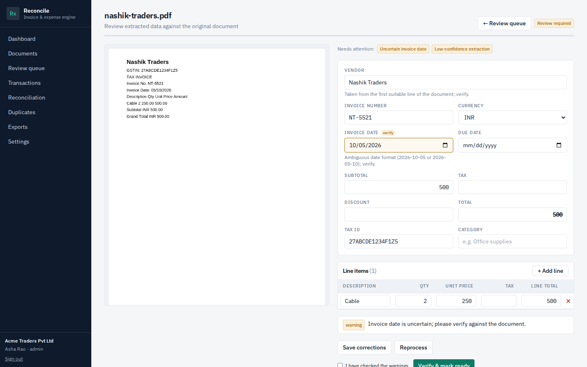
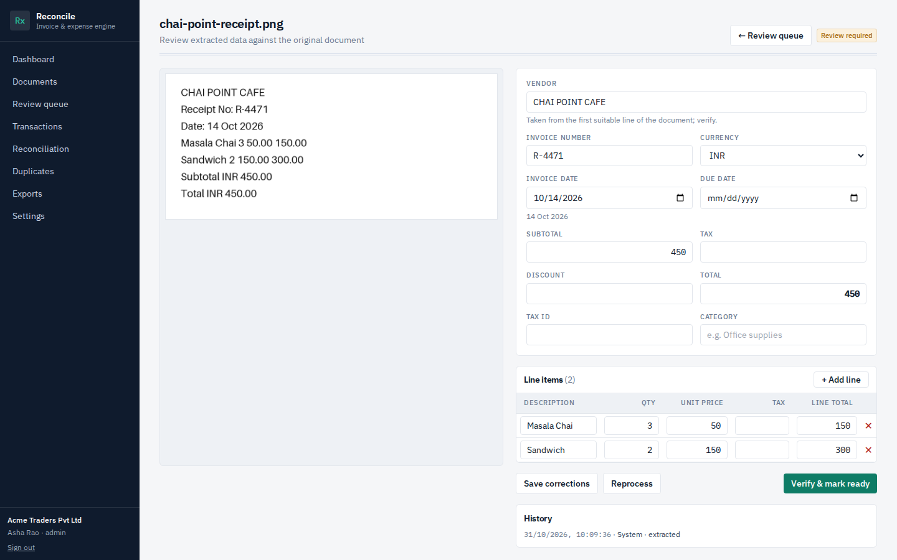
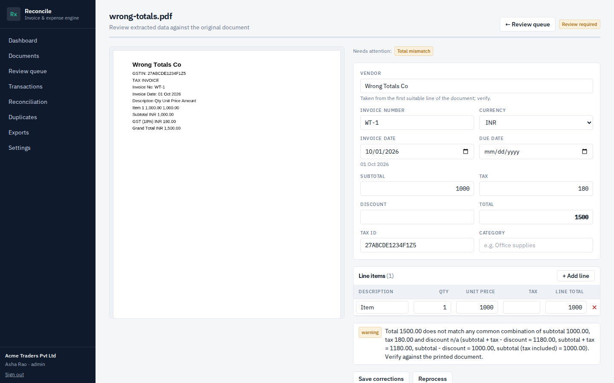
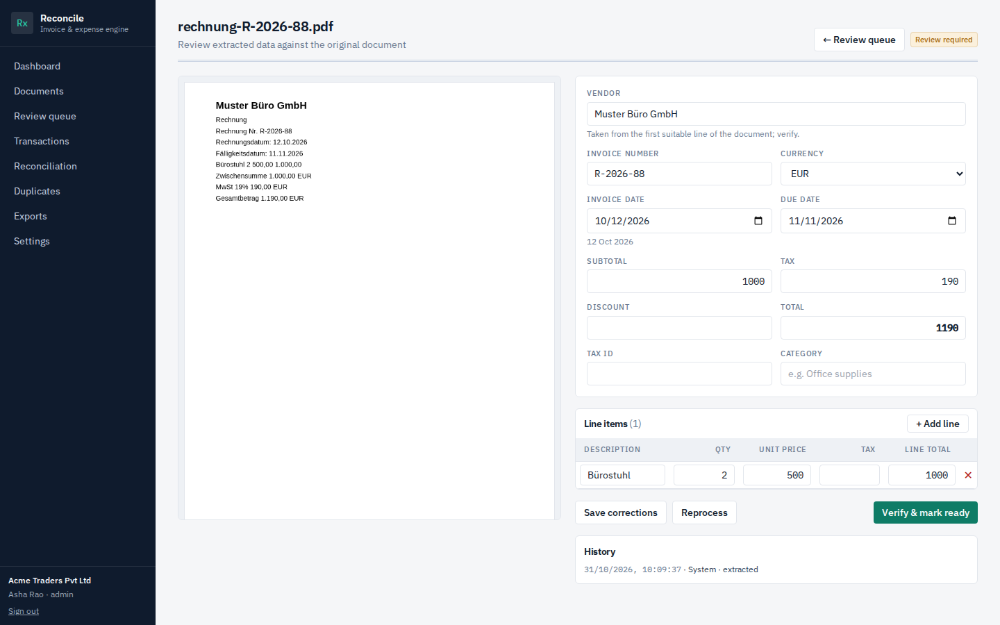
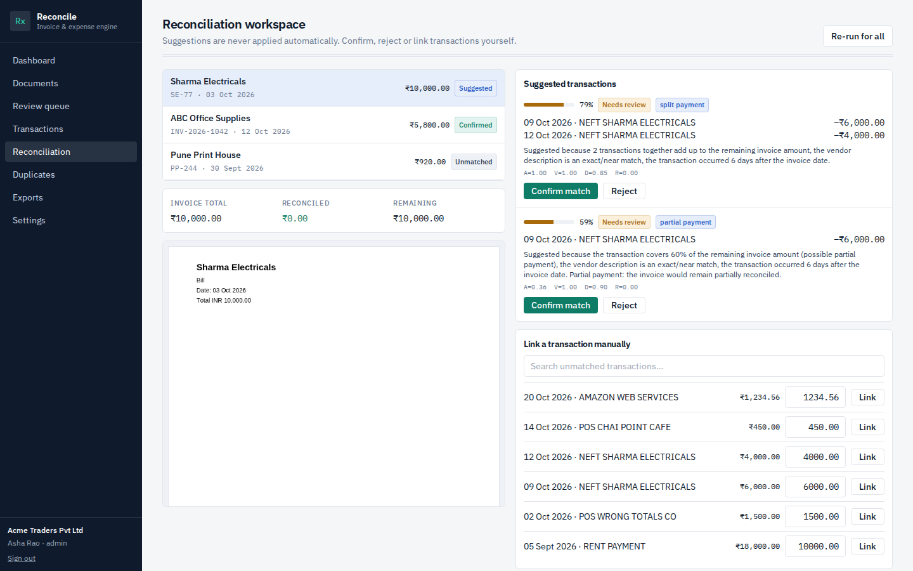
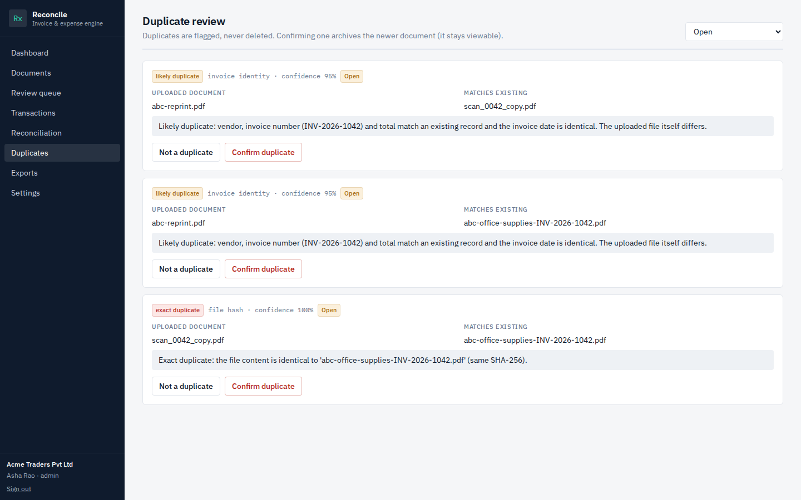
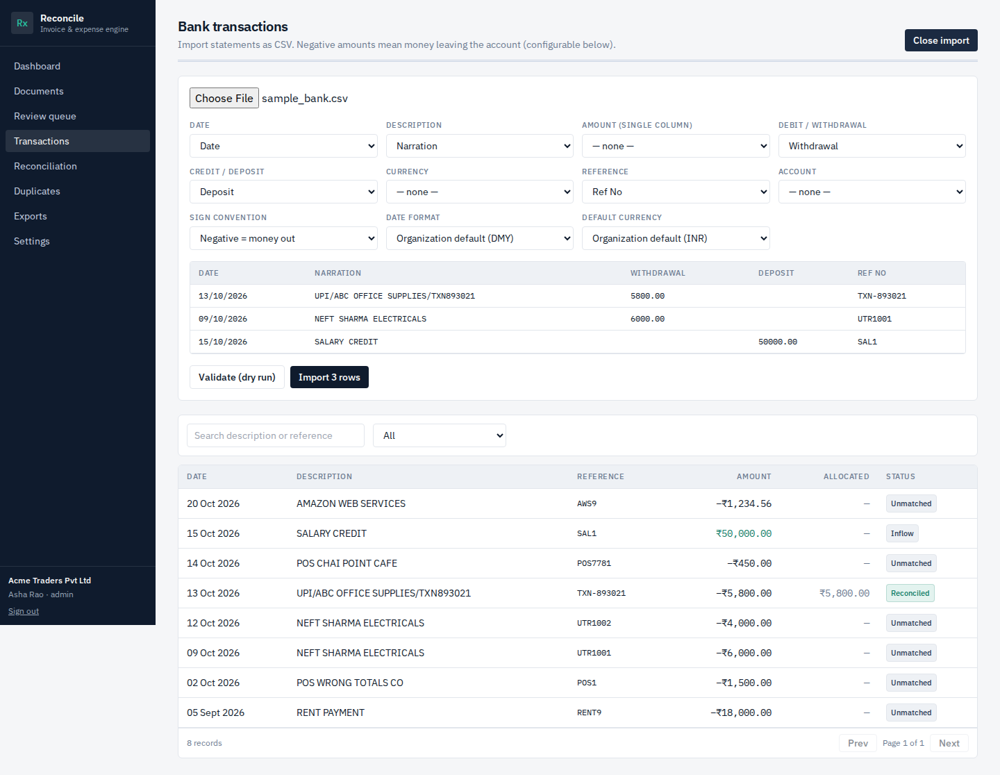
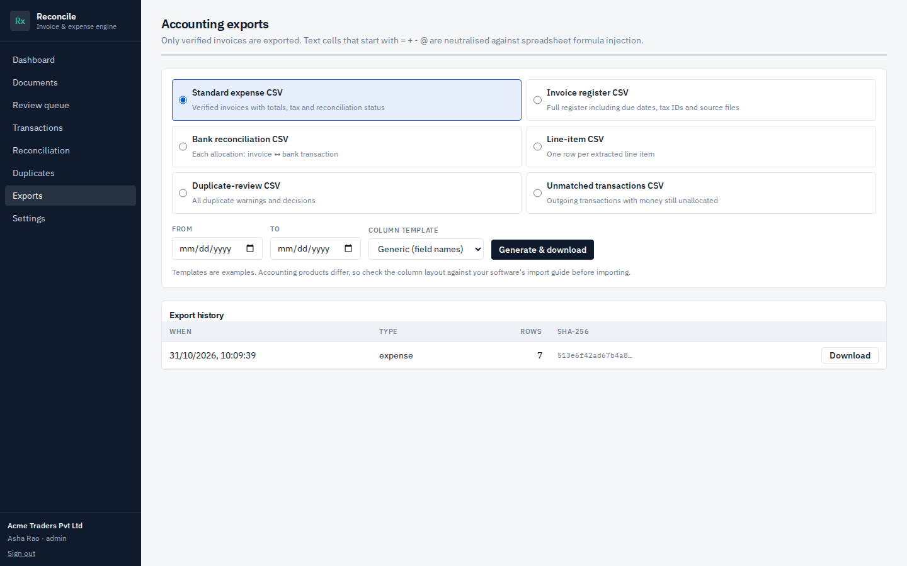

# AI Invoice & Expense Reconciliation Engine

Upload invoices and receipts (digital PDF, scanned PDF, JPEG, PNG) → extract structured data with native PDF text or Tesseract OCR →
review and correct → import bank CSVs → get **explainable** invoice↔transaction match suggestions (including partial and split
payments) → detect duplicates → export verified records as CSV. Every consequential step is human-confirmed and audited.



## Screenshots (real UI, synthetic data)
| | |
|---|---|
|  **Review** – PDF.js preview, uncertain fields highlighted |  **OCR receipt** with the OCR-read vs. corrected values |
|  **Arithmetic validation** warning |  **German invoice**, EUR, `1.190,00` parsed correctly |
|  **Reconciliation** – split-payment suggestion with explanation |  **Duplicate review** with evidence |
|  **CSV import** – column mapping and sign convention |  **Exports** with history and checksums |

More in [`docs/screenshots`](docs/screenshots): login, documents, review queue, transactions, settings.

## Quick start (no Docker: SQLite + local Tesseract)
Prerequisites: Python 3.11+, Node 20+, `tesseract-ocr` (Ubuntu: `sudo apt install tesseract-ocr`; Windows: UB-Mannheim installer, add to PATH).
```bash
# 1. backend
cd backend
python -m venv .venv && source .venv/bin/activate        # Windows: .venv\Scripts\activate
pip install -r requirements-dev.txt
alembic upgrade head                                     # creates ./data/app.db
uvicorn app.main:app --reload --port 8000                # http://localhost:8000/docs

# 2. frontend (new terminal)
cd frontend && npm ci && npm run dev                     # http://localhost:5173 (proxies /api to :8000)

Without a `.env` the defaults are development-safe (SQLite, background tasks, `SECRET_KEY` insecure default — refused in production).
Low-RAM Windows machines: this setup needs only the API process; Redis/Celery are optional.

## Docker Compose (PostgreSQL + API + web)
```bash
cp .env.example .env        # set SECRET_KEY to a long random value
docker compose up --build   # web: http://localhost:8080  api docs: http://localhost:8000/docs
docker compose --profile celery up --build   # + Redis + Celery worker (set PROCESSING_MODE=celery in .env)
```
> The Compose/PostgreSQL/Celery path was not executable in the environment this project was built in — see [known limitations](docs/known-limitations.md).

## Tests
```bash
cd backend  && python -m pytest -q                       # 113 tests (unit + integration + migrations + e2e workflow)
cd frontend && npm run typecheck && npm test && npm run build   # 21 tests
```

## Regenerating screenshots
```bash
pip install playwright && playwright install chromium
cd frontend && npm run build && npx vite preview --port 4173 &   # with the API + seed data running
python scripts/take_screenshots.py
```

## Try the acceptance scenario by hand
1. Sign in, **Documents → drop** `backend/tests/fixtures` generated invoices (or use the seeded ones).
2. **Review queue → Review** an invoice, fix highlighted fields, **Verify**.
3. **Transactions → Import CSV** (`backend/tests/fixtures/sample_bank.csv`), check the mapping, import.
4. **Reconciliation** → select the invoice → read the explanation → **Confirm match**.
5. Upload the same PDF again → **Duplicates** shows an *exact duplicate* with evidence.
6. **Exports → Generate** → verified invoice register CSV.

## Roles
Admin (all) · Accountant (verify, reconcile, review duplicates, export, delete) · Contributor (upload, correct — cannot verify) · Viewer (read-only).
Enforced on the server; the UI only hides buttons.

## Configuration (`.env`)
See [`.env.example`](.env.example): `SECRET_KEY`, `DATABASE_URL`, `STORAGE_DIR`, `MAX_UPLOAD_MB`, `MAX_PAGES`, `OCR_LANGUAGES`
(e.g. `eng+deu`), `OCR_TIMEOUT_SECONDS`, `PROCESSING_MODE` (`inline|background|celery`), `CORS_ORIGINS`.

## Documentation
[Architecture](docs/architecture.md) · [API](docs/api.md) · [Database](docs/database-schema.md) · [Security](docs/security.md) ·
[Testing](docs/testing.md) · [**Known limitations**](docs/known-limitations.md)

## Project layout
```
backend/   FastAPI app (api, core, processors, services, workers), Alembic migrations, tests
frontend/  React + TypeScript + Vite + Tailwind, PDF.js, Recharts, Vitest
scripts/   seed_demo_data.py, take_screenshots.py, generate_test_invoices.py
docs/      architecture, API, schema, security, testing, limitations, screenshots
```

## Honest status
Implemented and tested: everything in the MVP list of the specification. No accuracy percentage is claimed — the synthetic
fixtures prove behaviour, not real-world OCR accuracy. Direct bank connectivity, ML-assisted ranking, cross-currency matching,
accounting-software adapters and email ingestion are deliberately deferred (see limitations).
